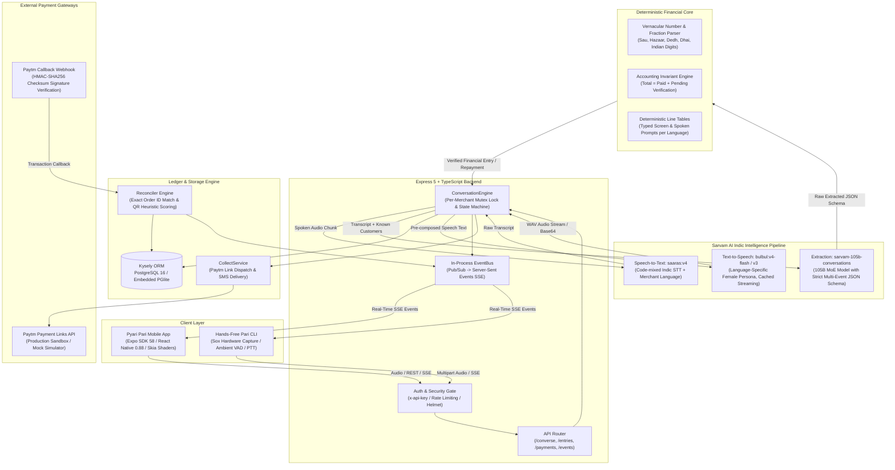
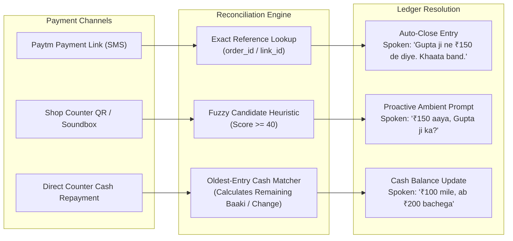

# Pari Architecture & Technical Specifications

This document provides a comprehensive technical breakdown of Pari's ambient voice engine, state machine, financial guardrails, and payment reconciliation mechanisms.

---

## 1. End-to-End System Architecture



---

## 2. Conversation State Machine

Every merchant session is protected by a serialized mutex lock preventing race conditions during rapid audio inputs.

```mermaid
stateDiagram-v2
    [*] --> IDLE

    IDLE --> AWAITING_CUSTOMER_CHOICE: Name ambiguity ("Gupta didi" for Gupta ji)
    AWAITING_CUSTOMER_CHOICE --> AWAITING_ENTRY_CONFIRM: Same person ("Haan") or a new khaata ("Nahi")

    IDLE --> AWAITING_ENTRY_CONFIRM: Merchant utters udhar entry
    AWAITING_ENTRY_CONFIRM --> AWAITING_ENTRY_CONFIRM: Merchant corrects amounts ("Nahi, 250 diye" or "Haan, lekin 250 diye")
    AWAITING_ENTRY_CONFIRM --> AWAITING_ENTRY_CONFIRM: Someone else's entry queued; this one asked again
    AWAITING_ENTRY_CONFIRM --> IDLE: Merchant rejects ("Nahi / Galat")
    AWAITING_ENTRY_CONFIRM --> IDLE: Confirmed & Fully Paid (Pending = 0)
    AWAITING_ENTRY_CONFIRM --> AWAITING_COLLECT_CHOICE: Confirmed & Pending > 0 ("Save karoon? -> Haan")

    IDLE --> IDLE: Balance question answered ("Gupta ji ka kitna baaki hai?")
    IDLE --> AWAITING_NAME: Missing customer name ("200 ka saamaan diya")
    IDLE --> AWAITING_AMOUNT: Missing amount ("Gupta ji ne paise diye")
    AWAITING_NAME --> AWAITING_ENTRY_CONFIRM: Name supplied ("Verma ji")
    AWAITING_AMOUNT --> AWAITING_PAYMENT_CONFIRM: Amount supplied ("Dedh sau")

    IDLE --> AWAITING_PAYMENT_CONFIRM: Cash repaid at counter ("Gupta ji ne 100 diye")
    AWAITING_PAYMENT_CONFIRM --> IDLE: Confirmed ("Haan") -> Applied to oldest open entries
    AWAITING_PAYMENT_CONFIRM --> AWAITING_PAYMENT_CONFIRM: Corrected ("Nahi, 150 diye")
    AWAITING_PAYMENT_CONFIRM --> IDLE: Rejected ("Nahi") -> Nothing recorded

    AWAITING_COLLECT_CHOICE --> IDLE: Declines payment link ("Nahi")
    AWAITING_COLLECT_CHOICE --> IDLE: Accepts & phone already saved (Link dispatched)
    AWAITING_COLLECT_CHOICE --> AWAITING_PHONE_CONFIRM: Accepts & speaks phone number directly
    AWAITING_COLLECT_CHOICE --> AWAITING_PHONE: Accepts but customer phone unknown

    AWAITING_PHONE --> AWAITING_PHONE_CONFIRM: Valid 10-digit mobile spoken
    AWAITING_PHONE --> AWAITING_PHONE: Invalid phone (Re-prompts merchant)
    AWAITING_PHONE --> IDLE: Declines phone entry ("Nahi / Rehne do")

    AWAITING_PHONE_CONFIRM --> IDLE: Confirmed ("Haan") -> Paytm Link Sent via SMS
    AWAITING_PHONE_CONFIRM --> AWAITING_PHONE: Rejected ("Nahi") -> Re-prompt number

    IDLE --> AWAITING_QR_MATCH: Shop QR payment received with multiple candidates
    AWAITING_QR_MATCH --> IDLE: Merchant confirms candidate ("Haan, Gupta ji ka")
    AWAITING_QR_MATCH --> AWAITING_QR_MATCH: Rejects candidate ("Nahi") -> Checks next candidate
    AWAITING_QR_MATCH --> IDLE: All candidates rejected -> Set aside as UNMATCHED
```



---

## 3. Dual-Channel & Counter Cash Reconciliation



### Heuristic Scoring Formula for Shop QR Payments:
$$\text{Score} = S_{\text{amount}} + S_{\text{name}} + S_{\text{recency}}$$

* **Amount Match ($S_{\text{amount}}$)**: $+100$ for exact pending match, $+40$ for partial payment, $+20$ for overpayment.
* **Payer Name Similarity ($S_{\text{name}}$)**: Up to $+60$ based on Jaro-Winkler string distance against known customer records.
* **Recency Decay ($S_{\text{recency}}$)**: Up to $+10$ decaying over a 30-day window.

---

## 4. 11 Indic Languages Matrix

| Language | Script | STT Code | TTS Model | Voice Persona | Interface Display |
| :--- | :--- | :--- | :--- | :--- | :--- |
| **Hindi** | हिन्दी | `hi-IN` | `bulbul:v4-flash` | `simran_enhi_customer` | Hinglish & Devanagari |
| **English** | English | `en-IN` | `bulbul:v4-flash` | `simran_en_customer` | Latin / Indian English |
| **Bengali** | বাংলা | `bn-IN` | `bulbul:v4-flash` | `roopa_bn_conversational` | Bengali Script |
| **Tamil** | தமிழ் | `ta-IN` | `bulbul:v3` | `simran` | Tamil Script |
| **Telugu** | తెలుగు | `te-IN` | `bulbul:v4-flash` | `kavitha_te_conversation` | Telugu Script |
| **Kannada** | ಕನ್ನಡ | `kn-IN` | `bulbul:v4-flash` | `chaitra_kn_conversation` | Kannada Script |
| **Malayalam** | മലയാളം | `ml-IN` | `bulbul:v3` | `simran` | Malayalam Script |
| **Marathi** | मराठी | `mr-IN` | `bulbul:v4-flash` | `ishita_mr_conversational` | Devanagari Script |
| **Gujarati** | ગુજરાતી | `gu-IN` | `bulbul:v4-flash` | `pooja_gu_customer` | Gujarati Script |
| **Punjabi** | ਪੰਜਾਬੀ | `pa-IN` | `bulbul:v3` | `simran` | Gurmukhi Script |
| **Odia** | ଓଡ଼ିଆ | `od-IN` | `bulbul:v3` | `simran` | Odia Script |

---

## 5. Database Schema

Built using **Kysely** query builder over PostgreSQL (or embedded **PGlite** for zero-dependency local runs):

```
 merchants ──< customers ──< ledger_entries ──< payment_links
                                  │
 payments ────────────────────────┘ (via entry_id & match_status)
                                  │
 audit_log ───────────────────────┴ (immutable transition events)
```

* **`merchants`**: Identity, API keys, shop name, UPI ID, and chosen language (`ta-IN`, `hi-IN`, etc.).
* **`customers`**: Normalized names (`name_normalized`), phone numbers, and merchant associations.
* **`ledger_entries`**: Financial state (`UNCONFIRMED`, `OPEN`, `CLOSED`, `REJECTED`), amounts in integer paise, audio transcripts, review flags.
* **`payment_links`**: Paytm link records with short URLs and order tokens (`orderId`).
* **`payments`**: `LINK`, `QR`, and `CASH` transactions with matching status (`SUGGESTED`, `MATCHED`, `UNMATCHED`, `REJECTED`).
* **`audit_log`**: Tamper-evident transition audit trail logging actor (`merchant`, `paytm`, `system`) and payloads.

