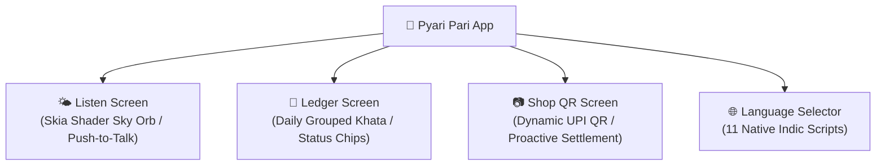

<div align="center">

# 📱 Pyari Pari — Mobile & Web Client
### Ambient Voice-First Udhar Ledger Frontend for Indian Kirana Merchants

[](https://expo.dev/)
[](https://reactnative.dev/)
[](https://react.dev/)
[](https://www.typescriptlang.org/)
[](https://shopify.github.io/react-native-skia/)
[](https://docs.swmansion.com/react-native-reanimated/)
[](https://tanstack.com/query)

<br/>

[Overview](#-overview) • [Core Features](#-core-features) • [Quickstart](#-quickstart--local-setup) • [Android Physical Device](#-running-on-an-android-device) • [Demo Tools](#-interactive-demo-tools) • [Architecture](#-project-architecture)

---

</div>

## 📌 Overview

**Pyari Pari Frontend** is a modern, responsive mobile and web client designed for fast-paced retail counters. Powered by **Expo SDK 58** and **React Native 0.88**, it pairs directly with the [Pari Backend API](../backend) to deliver an ambient, zero-friction financial recording experience.

The merchant speaks naturally, verifies extracted credit amounts via read-backs, and sends SMS payment links without manual keyboard entry.

---

## ✨ Core Features



### 1. 🌤️ Listen (Ambient Voice Interface)
* **Animated Skia Sky Orb**: Fluid generative sky visualization representing Pari's listening, thinking, and speaking states.
* **Push-to-Talk Audio**: Tap the sky to start recording; tap again to send. Completely avoids premature silence cutoffs in noisy shop environments.
* **Instant Read-Back & Spoken Confirmation**: Shows Pari's breakdown card (Total, Paid, Pending) while playing Bulbul TTS audio in the merchant's language.
* **Zero-Mistake Invariant Guardrails**: Confirm entries with a single tap or say *"Haan"* / *"Nahi, 250 diye"*.

### 2. 📖 Ledger (Khata Overview)
* **Real-Time Financial Metrics**: Instant snapshot of "To collect" (total pending credit), "Collected today", and "Open entries".
* **Daily Grouped Entries**: Chronological cards grouped by date with customer names, amounts, and statuses (`OPEN`, `CLOSED`, `REJECTED`).
* **Filtering**: Seamlessly toggle between **All**, **Open**, and **Closed** entries.

### 3. 📷 Shop QR (Counter UPI Code)
* **Dynamic UPI QR Code**: Renders the shop's payment intent payload.
* **Proactive Candidate Matching**: When an unlinked QR payment hits the shop, a modal card steps through candidates (*"₹150 aaya, Gupta ji ka?"*) with one-tap confirmation.

### 4. 🌐 11 Indic Languages
* Supports Hindi, English, Bengali, Tamil, Telugu, Kannada, Malayalam, Marathi, Gujarati, Punjabi, and Odia.
* String tables are strictly typed against a shared `Strings` interface in [`src/i18n/strings/`](src/i18n/strings/) so missing translations trigger compile-time type errors.

---

## 🚀 Quickstart & Local Setup

### Prerequisites
* **Node.js**: `v20.12+`
* **Backend Running**: Start the backend on `http://localhost:4000` first (see [`backend/README.md`](../backend/README.md)).

### 1. Install Dependencies
```bash
cd frontend
npm install
```
> [!NOTE]
> `npm install` automatically runs `postinstall` to configure Skia's `canvaskit.wasm` for web execution.

### 2. Configure Environment (`.env.local`)
```bash
cp .env.example .env.local
```
Ensure the following variables are set:
```ini
EXPO_PUBLIC_API_URL=http://localhost:4000
EXPO_PUBLIC_API_KEY=pari-dev-key
EXPO_PUBLIC_DEMO_TOOLS=true
```

### 3. Run in Web Browser
```bash
npx expo start --web
```
*Your browser will request microphone permission the first time you tap the sky orb.*

---

## 🤖 Running on an Android Device

For realistic testing with hardware audio recording, run on a physical Android phone via USB debugging:

### 1. Enable Port Forwarding (ADB)
```bash
# Forward backend API port
adb reverse tcp:4000 tcp:4000

# Forward Metro bundler port
adb reverse tcp:8081 tcp:8081
```

### 2. Compile & Launch Native Build
```bash
npx expo run:android
```

> [!TIP]
> **Fast Arm64 Compilation**: `android/gradle.properties` has `reactNativeArchitectures=arm64-v8a` configured, ensuring fast compile times by skipping unnecessary x86 and 32-bit slices.

### Native Permissions & Audio
* **Microphone Access**: `RECORD_AUDIO` and `MODIFY_AUDIO_SETTINGS` permissions are pre-configured in `android/app/src/main/AndroidManifest.xml`.
* **Cleartext Traffic**: Enabled in `app.json` via `expo-build-properties` to permit communication with `http://localhost:4000`.

---

## 🎮 Interactive Demo Tools

When `EXPO_PUBLIC_DEMO_TOOLS=true` and the backend is running with `PARI_PAYTM_MODE=mock`, shortcuts are available for seamless presentations:

* **Simulate Link Paid**: In the **Ledger** tab, **long-press** any row marked *"Link sent"*. The link is marked paid, the entry closes, and Pari speaks: *"Gupta ji ne ₹150 de diye. Khaata band."*
* **Simulate Shop QR Payment**: In the **QR** tab, **long-press** the shop's QR code. A simulated payment arrives matching the latest open entry, and Pari asks aloud: *"₹150 aaya, Gupta ji ka?"*.

> [!TIP]
> For the complete judge demonstration dialogue script, see [docs/DEMO_GUIDE.md](../docs/DEMO_GUIDE.md).

---

## 🏗️ Project Architecture

```
frontend/src/
├── app/                          # Expo Router file-based screens
│   ├── _layout.tsx               # Root provider wrapper (QueryClient, SafeArea, Fonts)
│   ├── (tabs)/                   # Bottom tab navigator
│   │   ├── _layout.tsx           # Custom blurred glass tab bar
│   │   ├── index.tsx             # Listen screen (Sky Orb & Voice turn cards)
│   │   ├── qr.tsx                # Shop QR & proactive match cards
│   │   └── ledger.tsx            # Daily grouped ledger & filters
│   └── language.tsx              # Modal language selection screen
├── features/                     # Domain feature modules
│   ├── listening/                # Sky orb, microphone hook, conversation store
│   ├── ledger/                   # Ledger lists, stat cards, entry details
│   └── qr/                       # Shop QR generator & suggestion actions
├── components/                   # Reusable UI elements
│   ├── ui/                       # Glass containers, buttons, segmented controls
│   └── icons/                    # Vector iconography
├── i18n/                         # Internationalization
│   └── strings/                  # 11 strictly typed language string tables
├── services/                     # Backend communication layer
│   ├── api-client.ts             # REST client with auth headers
│   ├── audio-recorder.ts         # Native & web audio recording abstraction
│   ├── speech-player.ts          # Low-latency audio stream playback
│   └── events.ts                 # Server-Sent Events (SSE) subscriber
├── theme/                        # Colors, typography, motion curves, spacing
└── types/                        # Financial models & API response types
```

---

## 🧪 Verification & Quality

```bash
# Type-check TypeScript files
npm run typecheck

# Lint codebase
npm run lint
```
